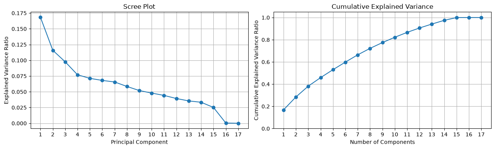
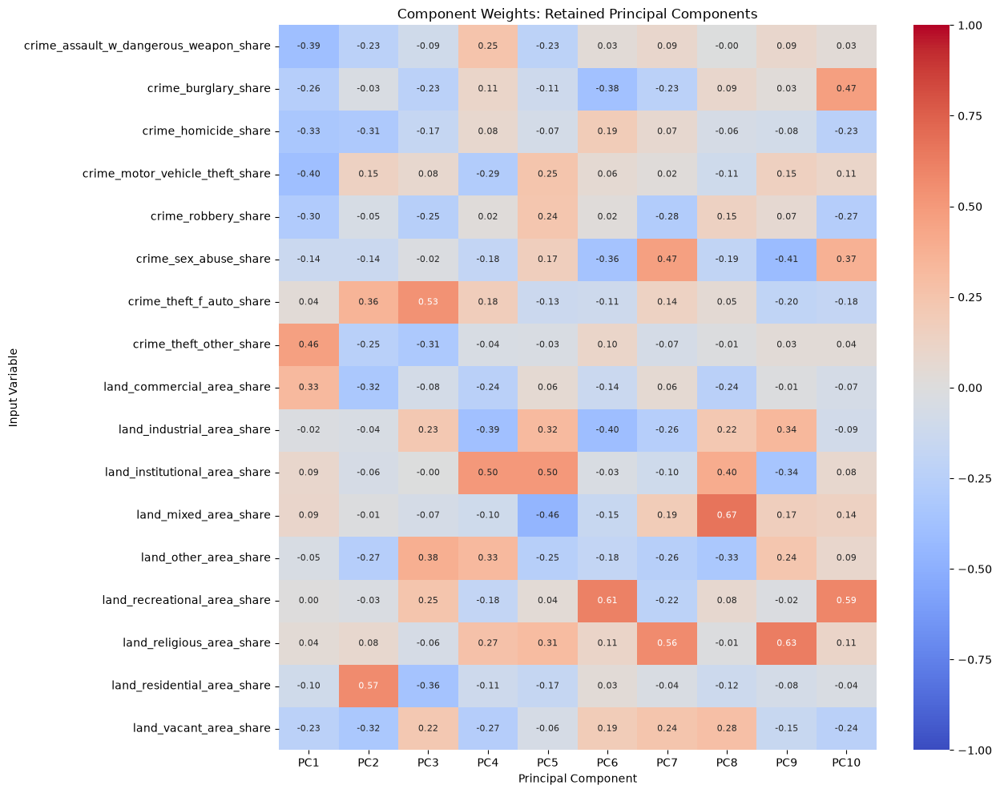
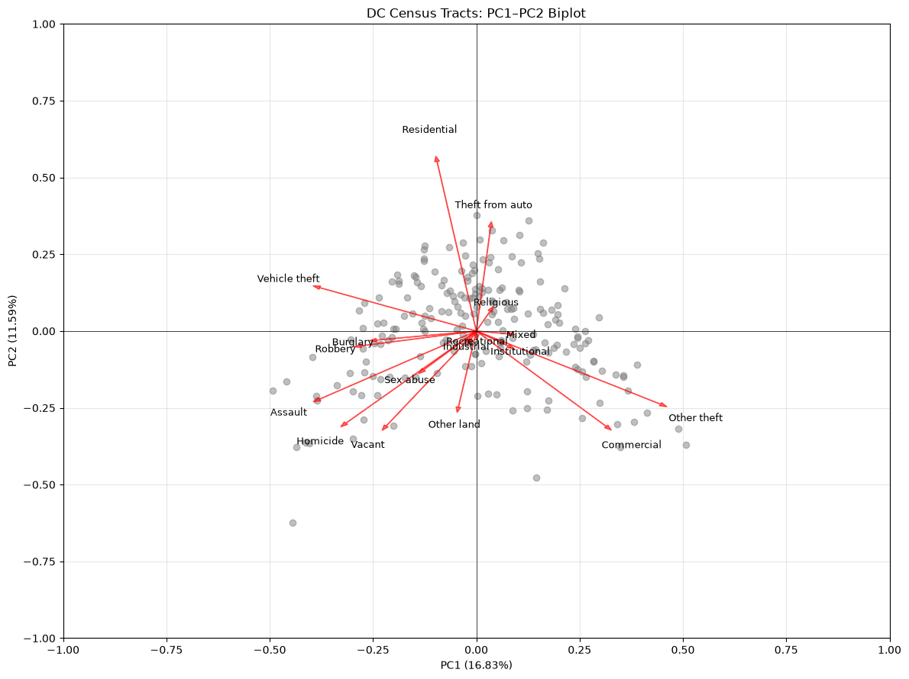

# CDS 303 Final Project 2: DC Crime and Land Use

**Team:** Seungeun Choi and Junhwa Hong  
**Stage:** Data integration, research question refinement, and PCA. Clustering and classification are reserved for a later project stage.

This project examines how the composition of crimes reported in 2025 and land-use composition vary across 206 Washington, DC census tracts. The PCA input contains 17 numerical percentages. Ten components retain 82.22% of standardized variance.

## Research question and intended audience

**Research question:** How do crime-type proportions and land-use area proportions vary across Washington, DC census tracts, and what tract profiles can later clustering identify from these characteristics?

The current stage addresses the dimensions of variation. It does not establish tract clusters.

**Intended audience:** Crime analysts at Washington, DC’s Metropolitan Police Department (MPD) who examine local crime patterns. This is a proposed audience; the project was not commissioned or validated by MPD.

**Relevance:** Total crime counts do not describe the relative frequency of offense types. Comparing offense composition together with land-use composition provides another way to describe differences among tracts.

**Potential use:** Analysts could identify comparison tracts and formulate questions for subsequent local analysis, such as why tracts with similar land-use proportions have different offense proportions. This project does not estimate crime risk, establish causation, or determine patrol or investigation priorities.

## Data sources and reference periods

| Dataset | Role and reference period | Original local input expected by the notebook |
|---|---|---|
| [Crime Incidents in 2025](https://opendata.dc.gov/datasets/DCGIS::crime-incidents-in-2025) | Primary data; filtered by report year 2025 in DC local time | `Downloads/Crime_Incidents_-_2025.csv` |
| [DCGIS Existing Land Use](https://opendata.dc.gov/datasets/DCGIS::existing-land-use) | Supplementary polygons; see the dated metadata clarification below | `Downloads/Existing_Land_Use/` containing exactly one `.shp` and its companion files |
| [2025 Census TIGER/Line DC tracts](https://www2.census.gov/geo/tiger/TIGER2025/TRACT/tl_2025_11_tract.zip) | Geographic framework; DC state FIPS `11` | `Downloads/tl_2025_11_tract.zip` |

**Land-use metadata clarification, checked November 22, 2026:** The [official metadata](https://www.arcgis.com/sharing/rest/content/items/4dbc33ec9ee44e2092f23ea072501533/info/metadata/metadata.xml?format=default&output=html) describes an August 2026 common-ownership-lot extract, with a process date of August 4, 2026, using a property-use-code lookup dated August 2025. The layer is therefore not verified as a 2025 land-use snapshot. These dates describe source processing, not a single observation date for every property. This clarification supersedes the earlier general statement that no reference-period information was available. The precise downloaded source-file version is not recorded in the supplied notebook.

The local crime extract contains 24,151 records. These counts describe that extract, not a guaranteed complete or permanently fixed annual total. Download dates and checksums for all original source files were not recorded. Live downloads may change.

## Integration and preprocessing

### Unit, identifiers, and merge checks

- One combined row represents one census tract, identified by the 11-character `GEOID`.
- Crime `CENSUS_TRACT` is retained as `original_tract` and matched to boundary `TRACTCE`. DC `TRACTCE` is a six-character code; the lookup supplies the full GEOID.
- IDs are read as strings to preserve leading zeros. IDs are not PCA inputs.
- Crime is aggregated to tract-level counts and percentages; land-use polygons are intersected with tract boundaries and summarized by category area.
- The final merge uses `validate='one_to_one'` and checks unique GEOIDs, 206 rows, and presence in both summary tables. These checks prevent unintended multiplication of rows.

### Crime preparation

Report timestamps are parsed as UTC and converted to `America/New_York` before selecting report year 2025. This selects reporting year, not necessarily occurrence year. Inspection of the supplied record-level audit found 216 records with a start year earlier than 2025; one end timestamp preceded its start timestamp. The PCA does not use incident duration.

Repeated CCNs are flagged and retained: three repeated case numbers cover six rows. Repeated case numbers alone do not prove redundant records, and the reason for each repetition has not been established.

The notebook first assigns points spatially for comparison, then preserves that result as `crime_spatial_audit` and uses original tract codes for final aggregation. Coordinate assignment produced 78 unassigned records and 3,796 differences from nonmissing original codes. Final original-code matching retained 24,145 records and left six without an original tract code. These are separate diagnostics.

The [crime source metadata](https://catalog.data.gov/dataset/crime-incidents-in-2025) states that, from 2020 onward, tract values are calculated before block-level anonymization. That supports using the supplied tract code rather than treating released block coordinates as precise incident locations. It does not establish the cause of every observed mismatch.

For tract t and offense k, `crime_share(t,k) = 100 × offense_records(t,k) / all_eligible_crime_records(t)`. These are record-composition percentages, not population-based crime rates. A zero total would produce missing shares rather than an assumed 0%; no final tract had a zero total in the supplied extract.

### Land-use preparation

The notebook repairs geometries, retains polygon parts, and projects to EPSG:5070 for area calculations in square meters. Same-category polygons are dissolved before intersection with tract boundaries. Missing category labels are retained as `Unknown` if present.

Different-category intersections are unioned to identify conflict area. That area is removed from each original category and counted once as `Overlap_Unresolved`; no category is given arbitrary priority. This quality category is separate from the source’s `Mixed` category. Exclusive areas plus conflict area recover actual mapped area within the specified numerical tolerance.

For tract t and category j, `land_share(t,j) = 100 × exclusive_category_area(t,j) / mapped_area(t)`. Mapped area includes conflict area once. The denominator is not total tract area. Removing unresolved overlap from PCA therefore does not remove its influence on other percentages.

There are 98 tracts flagged for category-overlap review. Nineteen tracts have unresolved-area shares above 5%, and six above 10%; these percentages are descriptive, not validated exclusion thresholds. Maximum unresolved share is 27.69%. Raw `overlap_pct` measures excess category-counted area and can differ from the unresolved union-area percentage. All 206 tracts have some mapped area; coverage ranges from 18.86% to 95.45% of tract polygon area. Partial coverage is not automatically proof of error, but proportions describe mapped land only.

## PCA input and variable selection

| Variable | Meaning | PCA input |
|---|---|---|
| `crime_assault_w_dangerous_weapon_share` | Assault with a dangerous weapon, % of tract crime records | Yes |
| `crime_burglary_share` | Burglary, % of tract crime records | Yes |
| `crime_homicide_share` | Homicide, % of tract crime records | Yes |
| `crime_motor_vehicle_theft_share` | Motor vehicle theft, % of tract crime records | Yes |
| `crime_robbery_share` | Robbery, % of tract crime records | Yes |
| `crime_sex_abuse_share` | Source category SEX ABUSE, % of tract crime records | Yes |
| `crime_theft_f_auto_share` | Theft from automobiles, % of tract crime records | Yes |
| `crime_theft_other_share` | Source category THEFT/OTHER, % of tract crime records | Yes |
| `land_commercial_area_share` | Commercial, % of mapped area | Yes |
| `land_industrial_area_share` | Industrial, % of mapped area | Yes |
| `land_institutional_area_share` | Institutional, % of mapped area | Yes |
| `land_mixed_area_share` | Mixed, % of mapped area | Yes |
| `land_other_area_share` | Other, % of mapped area | Yes |
| `land_recreational_area_share` | Recreational, % of mapped area | Yes |
| `land_religious_area_share` | Religious, % of mapped area | Yes |
| `land_residential_area_share` | Residential, % of mapped area | Yes |
| `land_vacant_area_share` | Vacant, % of mapped area | Yes |
| `crime_arson_share` | Arson; 202 of 206 tract values are zero | No: sparse input |
| `GEOID` | Tract identifier | No: identifier |
| `crime_records` | All eligible crime records per tract | No: retained as context |
| `land_overlap_unresolved_area_share` | Unresolved category-overlap union, % of mapped area | No: quality indicator |
| `mapped_area_m2` | Actual mapped union area including conflict once, m² | No: coverage context |
| `mapped_tract_area_pct` | Mapped area / total tract polygon area × 100 | No: coverage indicator |
| `missing_share_values` | Number of missing composition values in a combined row | No: diagnostic |

All percentages use the 0–100 scale. Full land-category percentages, including unresolved overlap, sum to 100%; the nine selected land-use percentages need not sum to 100%. Likewise, arson is excluded from PCA but remains in the crime denominator.

Raw `OFFENSE` and `PRIMARYLU` are categorical. PCA uses tract-level numerical percentages, not categorical labels or arbitrary category codes. The selected 206 × 17 input has no missing, infinite, or constant-valued columns; no imputation was needed.

Arson was excluded because approximately 98.1% of tracts have zero values, so standardization could amplify a few nonzero observations. This is a methodological choice, not proof that arson distorts the result; an inclusion/exclusion sensitivity comparison has not been performed.

`StandardScaler` gives each selected variable mean zero and population variance one before PCA. Percentages can have very different variances despite sharing a unit. Standardization prevents raw variance differences alone from setting variable influence. Variables within each thematic block still contribute jointly; equal variable scaling does not guarantee equal weighting of crime and land use as blocks.

## PCA results and discussion

### Component selection

PCA follows the instructor’s `CDS303_Demo_06.ipynb`: standardization, full PCA, explained-variance inspection, coefficient interpretation, and biplot. All 17 components were computed before selection. The minimum count meeting an analyst-selected 80% cumulative threshold was ten: nine explain 77.42%, and ten explain 82.22%. The first three explain 38.19%, so a two- or three-component reduction loses substantial information.

| Component | Explained variance (%) | Cumulative variance (%) |
|---|---:|---:|
| PC1 | 16.83 | 16.83 |
| PC2 | 11.59 | 28.42 |
| PC3 | 9.77 | 38.19 |
| PC4 | 7.70 | 45.88 |
| PC5 | 7.13 | 53.02 |
| PC6 | 6.80 | 59.82 |
| PC7 | 6.56 | 66.38 |
| PC8 | 5.85 | 72.22 |
| PC9 | 5.20 | 77.42 |
| PC10 | 4.79 | 82.22 |
| PC11 | 4.42 | 86.64 |
| PC12 | 3.93 | 90.57 |
| PC13 | 3.55 | 94.12 |
| PC14 | 3.34 | 97.45 |
| PC15 | 2.51 | 99.97 |
| PC16 | 0.03 | 100.00 |
| PC17 | 0.00 | 100.00 |

Values above are converted from the notebook’s displayed ratios rounded to four decimals. Cumulative percentages come from the displayed cumulative column rather than sums of rounded component percentages. PC17’s displayed 0.00% is a rounded result, not a claim of exact zero variance.

The scree plot shows a gradual decrease rather than a single dominant component. The 80% rule is an explicit selection choice, not a threshold prescribed by the assignment or evidence of an optimal clustering solution.

### Component interpretation

The following values are component weights from `pca.components_`, called loadings in Demo 6. They are coefficients used to calculate PC scores, not variable–PC correlation coefficients. Absolute magnitude indicates coefficient strength; signs indicate opposing directions. A full-axis sign reversal does not change a component’s meaning.

| Component | Main contrast among variables | Interpretation |
|---|---|---|
| PC1 | Other theft (+0.462), commercial (+0.327) vs motor vehicle theft (−0.395), assault with a dangerous weapon (−0.395), homicide (−0.329) | Crime-composition contrast with a commercial-land component |
| PC2 | Residential (+0.570), theft from auto (+0.356) vs Vacant (−0.324), commercial (−0.323), homicide (−0.312) | Residential-land and offense-composition contrast |
| PC3 | Theft from auto (+0.535), Other land (+0.384) vs residential (−0.364), other theft (−0.314) | Theft-from-auto and land-composition contrast |
| PC4 | Institutional and Other land vs industrial land and motor vehicle theft | Additional institutional–industrial land contrast |
| PC5 | Institutional, industrial, religious land vs Mixed and Other land | Additional land-composition contrast |
| PC6 | Recreational land vs industrial land, burglary, sex abuse | Recreational-land and offense-composition contrast |
| PC7 | Religious land and sex abuse vs robbery, industrial and Other land | Mixed crime and land-composition contrast |
| PC8 | Mixed and Institutional land vs Other and commercial land | Additional mixed/institutional land contrast |
| PC9 | Religious and industrial land vs sex abuse and Institutional land | Additional religious-land and offense-composition contrast |
| PC10 | Recreational land, burglary, sex abuse vs robbery, Vacant land, homicide | Additional recreation and offense-composition contrast |

These descriptions are tentative summaries of major coefficients, not pre-existing neighborhood labels. A variable may contribute outside the listed set. The source land-use category Other should not be read as a specific facility type, and source Mixed is not the overlap-quality category.

### Biplot and research relevance

Each point represents one tract. Other theft and commercial land point toward positive PC1; motor vehicle theft and assault point toward negative PC1. Residential land and theft from auto point toward positive PC2. Many points overlap around the origin, with some extending farther along the component directions.

The first two PCs represent only 28.42% of variation. Tracts close in this plot can differ on other retained components, and apparent groups are not confirmed clusters. Following Demo 6, point scores are rescaled separately by each axis range, so displayed distances do not preserve original score distances. Arrow angles are not exact correlations.

The results identify dimensions of tract variation rather than a single scale of crime severity. They provide a starting point for MPD analysts to compare tract characteristics and identify questions for follow-up analysis. For example, offense proportions can be compared across tracts with similar land-use proportions. Neither same-direction coefficients nor the biplot establish that land use causes a crime type.

### Limitations and later work

1. **Time mismatch:** Crime uses report year 2025; the source layer metadata describes an August 2026 lot extract with an August 2025 use-code lookup. The local source-file version is not documented, and same-year conditions are not established.
2. **Compositions:** Both blocks contain constrained percentages. Relative increases in one category can accompany decreases in others. Standardization does not remove this constraint.
3. **Sparse records:** Crime totals range from 3 to 600 per tract. Shares in low-count tracts may be unstable. Each tract is weighted equally in this PCA.
4. **Land uncertainty:** Unresolved overlap and partial mapped coverage remain. Excluding the overlap variable does not remove uncertainty from other land-use shares.
5. **Unperformed sensitivity checks:** Effects of low crime counts, unresolved-area exclusions, arson inclusion, and alternative composition handling have not been tested. Results are exploratory, not demonstrated to be robust.
6. **Units:** Census tracts are the analysis units and need not match lived neighborhoods or police operational boundaries. Tract-level patterns do not establish individual-level relationships.

Clustering and classification are not performed for Project 2. Later clustering can explore tract profiles using retained scores, with component retention reconsidered if later validation warrants it.

## Files and reproduction

The documentation bundle intentionally excludes existing notebooks, raw data, and processed CSVs. Add the notebook you already have at the repository root as [CDS303_Project2_Korean_Annotated.ipynb](CDS303_Project2_Korean_Annotated.ipynb). If retaining another filename, update this link. The three figures here were extracted unchanged from the uploaded notebook outputs, not generated by a new analysis.

| File | Purpose |
|---|---|
| `README.md` | Project 2 report, methods, results, discussion, references, and AI disclosure |
| `requirements.txt` | Direct notebook dependencies; versions intentionally unpinned |
| `.gitignore` | Excludes notebook checkpoints, caches, and an optional local raw-data directory |
| `SUBMISSION_CHECK_KO.md` | Korean rubric audit and remaining submission steps |
| `figures/` | Existing scree/cumulative, biplot, and retained-weight figures |

The supplied notebook metadata identifies Python 3.13.2. Exact installed package versions were not supplied, so this repository does not claim a fully locked environment. Install dependencies with `python -m pip install -r requirements.txt` and select that Python environment as the notebook kernel.

The notebook still expects Windows input paths under `C:\Users\user\Downloads`. The list of raw filenames above documents those assumptions; installing packages does not fix paths. Do not rename input data to an unrelated file. A shapefile requires its companion `.dbf`, `.shx`, and projection information. The full raw-data pipeline has not been rerun in the documentation environment.

Use the notebook from top to bottom. Re-running only the cell that copies `crime_linked` into `crime_spatial_audit` after final original-code matching can overwrite the intended spatial diagnostic. The notebook also writes an early spatial audit to the original output folder before later creating the timestamped preprocessing folder; existing locked files can still block that early export. These existing behaviors were documented, not changed.

The notebook exports preprocessing files under `Downloads/CDS303_Preprocessed_<timestamp>/` and PCA results under `Downloads/CDS303_PCA_<timestamp>/`. Preserve each run together to avoid mixing old coordinate-based aggregates with the final original-code aggregates. Read saved GEOID, tract-code, and case-number fields as strings.

Key existing files to add to the repository if desired are `tract_combined_unscaled.csv` and the PCA input, scores, weights, and explained-variance CSVs from the same final run. The notebook already exports them; this bundle does not regenerate them. Keep the original data snapshots available for reproducibility even if they are distributed separately from GitHub.

## Generative AI use

We used ChatGPT to help develop and troubleshoot preprocessing code, including tract aggregation, merging, overlapping land-use geometry handling, diagnostics, and exports. It helped explain errors and add Korean explanations for team review.

The instructor’s Demo 6 was the basis of the PCA workflow. ChatGPT helped adapt it to this dataset, discuss variable and component selection, implement visualizations, and interpret weights and the biplot. It also assisted with the research question, audience, and report drafts. The team ran the notebook and reviewed outputs; this does not mean all methodological sensitivities were tested. AI-assisted documentation was checked against supplied outputs and linked source metadata. The new metadata clarification above corrects an earlier overly general AI-assisted statement about temporal uncertainty.

## References

- DC Metropolitan Police Department / DCGIS. [Crime Incidents in 2025](https://opendata.dc.gov/datasets/DCGIS::crime-incidents-in-2025). [Catalog and geographic-assignment notes](https://catalog.data.gov/dataset/crime-incidents-in-2025).
- DC Office of the Chief Technology Officer, Office of Planning, and Office of Tax and Revenue. [Existing Land Use](https://opendata.dc.gov/datasets/DCGIS::existing-land-use). [Official metadata, including purpose, lineage, and category definitions](https://www.arcgis.com/sharing/rest/content/items/4dbc33ec9ee44e2092f23ea072501533/info/metadata/metadata.xml?format=default&output=html). Checked November 22, 2026.
- US Census Bureau. [2025 TIGER/Line census tract files](https://www2.census.gov/geo/tiger/TIGER2025/TRACT/), DC file `tl_2025_11_tract.zip`.
- CDS 303 course materials. `CDS303_Demo_06.ipynb`, supplied instructor notebook; basis for the PCA implementation.
- Instructor-provided *Final Project 2: Data Integration, Research Question Refinement & PCA* assignment text, supplied in the project conversation; basis for the scope and rubric audit.
